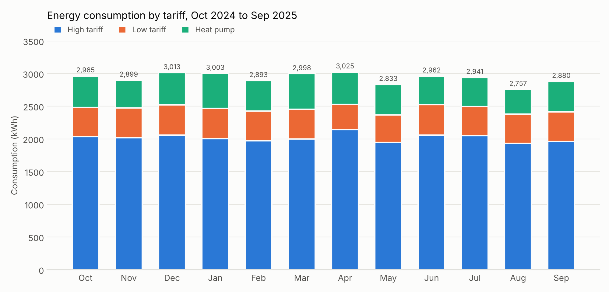
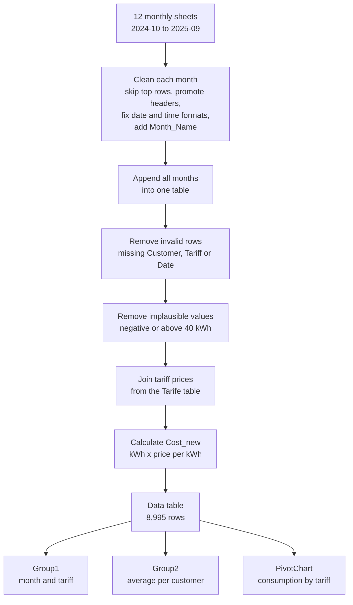

<h1 align="center">⚡ Energy Consumption Analysis with Power Query</h1>

<p align="center">
  Cleaning, merging and analysing twelve months of energy meter data in Excel with Power Query.
</p>

<p align="center">
  
  
  
  
</p>

<p align="center">
  
</p>

> **Note:** This project is my personal coursework, shared for portfolio and reference purposes only. The dataset is fictional. Please do not copy it and submit it as your own work, as that may count as plagiarism under your institution's rules.

## Table of contents

- [Overview](#overview)
- [Repository contents](#repository-contents)
- [The data](#the-data)
- [Workflow](#workflow)
- [What the cleaning steps do](#what-the-cleaning-steps-do)
- [Results](#results)
- [Notes and limitations](#notes-and-limitations)
- [How to open the workbook](#how-to-open-the-workbook)
- [Tools used](#tools-used)

## Overview

An energy utility delivers one Excel sheet of meter readings per month, and the sheets do not share a format. This project loads all twelve months (October 2024 to September 2025) with Power Query, brings them into one clean table, removes invalid and implausible rows, recalculates the cost of every reading from the tariff prices, and summarises consumption by month, tariff and customer.

Skills shown: Power Query (import, transform, append, merge, group), data cleaning, data type handling, outlier handling, tariff-based cost recalculation, and a PivotChart with a customer filter.

## Repository contents

```text
energy-consumption-power-query-analysis/
├── fn2026bin.xlsx         Finished workbook (queries, clean data table, groupings, PivotChart)
├── UE1_Energy.xlsx        Raw source data: 12 monthly sheets + tariff table
├── images/
│   └── consumption-by-tariff.png
└── README.md
```

| File | What it is |
|---|---|
| `fn2026bin.xlsx` | The finished workbook. The sheet **Data** holds the clean table (8,995 rows). **Group1** and **Group2** hold the groupings. **Chart** holds the PivotChart. The twelve monthly sheets and **Tarife** are the loaded source tables. |
| `UE1_Energy.xlsx` | The raw data the queries read from: one sheet per month (2024-10 to 2025-09) and one tariff sheet. |
| `images/` | Chart used in this README. |

## The data

The raw workbook contains about 9,600 meter readings across twelve monthly sheets, plus a small tariff table.

| Column | Meaning |
|---|---|
| `MeterPoint_ID` | Meter identifier |
| `Customer` | Customer name (8 customers: private, business, industrial and municipal) |
| `Tariff` | `HT` high tariff, `NT` low tariff, `WP` heat pump |
| `Date`, `Time` | When the reading was taken |
| `Consumption_kWh` | Energy used in the reading |
| `Cost_EUR` | Cost as supplied in the source data |

**Tariff table (`Tarife`)**

| Tariff | Description | Price per kWh |
|---|---|---|
| HT | High tariff | € 0.28 |
| NT | Low tariff | € 0.18 |
| WP | Heat pump | € 0.22 |

## Workflow



## What the cleaning steps do

1. **Import:** each monthly sheet is loaded as its own query, and the `Tarife` table is loaded as a lookup.
2. **Fix the headers:** the top rows above the column names are skipped and the real header row is promoted. Headers are standardized, for example `Consumption kWh` becomes `Consumption_kWh` and `MeterPointID` becomes `MeterPoint_ID`.
3. **Standardize dates and times:** the months did not use the same formats. Dates arrived as real dates, as text like `DD.MM.YYYY`, or as eight-digit numbers like `YYYYMMDD`. These are split and recombined into one real `Date` type. A `Month_Name` column is added.
4. **Append:** all twelve months are stacked into one table with *Append Queries*, and the result is called **Data**.
5. **Fix data types:** whole-number copies of the numeric columns are created (`Consumption_kWh_Int`, `Cost_EUR_Int`), and currency columns get a currency type.
6. **Remove errors and outliers:** rows with a missing customer, tariff or date are dropped, and so are readings that are negative or above 40 kWh.
7. **Recalculate cost:** each reading is joined to its tariff price (`Cost_EUR_kWh`) and `Cost_new = Consumption_kWh × Cost_EUR_kWh`. `Cost_Int_new` is the whole-number version, and `Compare` is the difference between the two.
8. **Group:** `Group1` sums consumption and cost by month and tariff. `Group2` averages consumption by customer.
9. **Visualize:** a PivotChart of **Data** shows consumption (sum of `Consumption_kWh`) by month, split by tariff, with a filter for the customer.

## Results

| Measure | Value |
|---|---|
| Period | 01.10.2024 to 30.09.2025 |
| Clean readings | 8,995 |
| Total consumption | 35,170 kWh |
| Total cost (recalculated from tariffs) | € 8,974.59 |

**Consumption and cost by tariff**

| Tariff | Consumption (kWh) | Share of consumption | Cost (€) |
|---|---|---|---|
| HT, high tariff | 24,190 | 68.8% | 6,773.10 |
| NT, low tariff | 5,353 | 15.2% | 963.62 |
| WP, heat pump | 5,627 | 16.0% | 1,237.87 |

**What the data shows**

- **Consumption is steady across the year.** Monthly totals range from 2,757 kWh (August) to 3,025 kWh (April), with no strong seasonal swing.
- **The high tariff dominates.** About 69% of all consumption falls in the high tariff, so it drives most of the cost.
- **Recalculating the cost mattered.** In 2,687 of the 8,995 rows the supplied `Cost_EUR` is above € 10 for readings of only a few kWh (for example € 112 for about 4 kWh), which looks like a scaling error in some months. Rebuilding the cost from tariff prices gives a consistent figure.

## Notes and limitations

- Some customer names in the source data have extra leading or trailing spaces. Without a trim step these appear as separate entries, so the customer grouping lists more than eight rows. Trimming the `Customer` column (`Text.Trim`) before grouping would merge them.
- `Cost_Int_new` and `Cost_EUR_Int` round to whole euros, as the exercise asks, so they are for comparison only.

## How to open the workbook

1. Open `fn2026bin.xlsx` in Excel. Power Query is built into Excel 2016 and later and into Microsoft 365, including Excel for Mac.
2. The tables and the PivotChart display with the data saved in the file.
3. To **refresh** the queries, point them at your copy of the raw data. Go to **Data → Queries & Connections**, open a query, click **Source** in *Applied Steps* and change the file path to where you saved `UE1_Energy.xlsx`. The queries save the path of the original computer, so this step is needed on any other machine.

## Tools used

- **Excel**: workbook, PivotTable and PivotChart
- **Power Query (M)**: import, cleaning, append, merge and grouping
